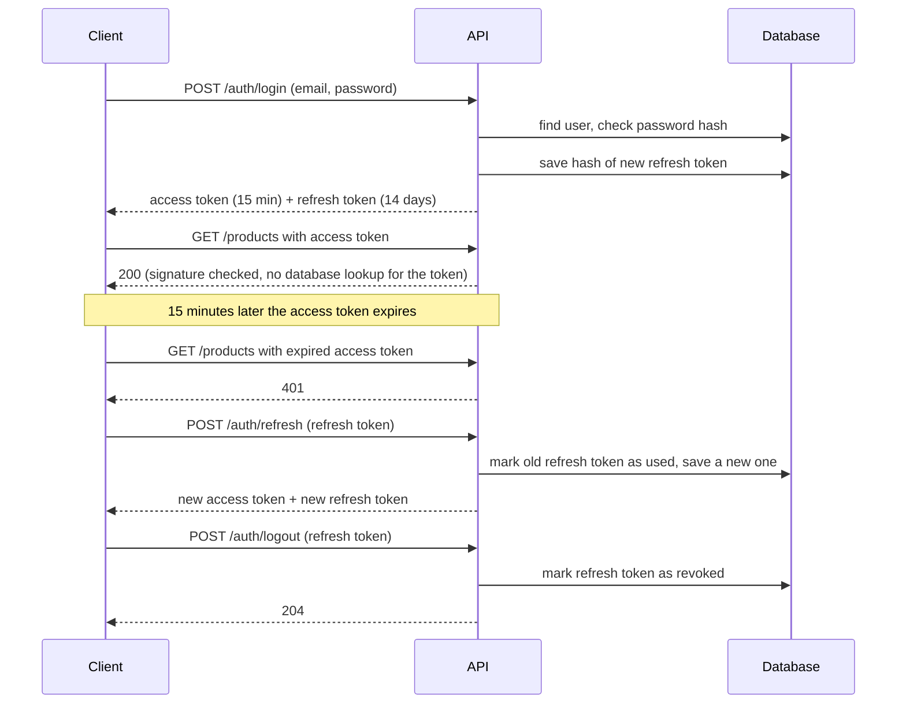
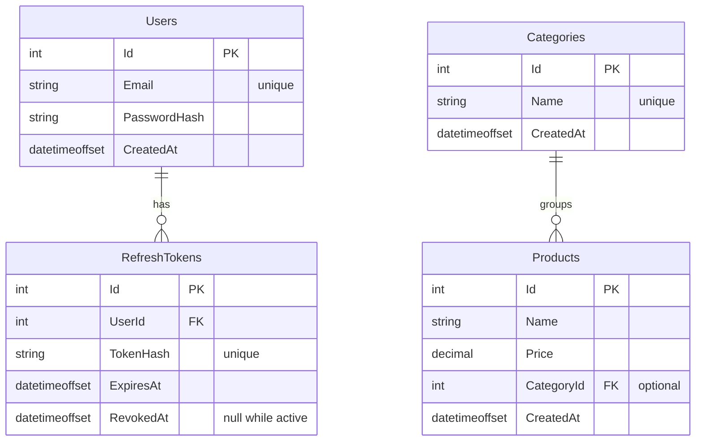

# Standard Minimal Web API

A small, complete reference for building a Web API with:

- **ASP.NET Core Minimal APIs** on .NET 10
- **SQL Server** through **Entity Framework Core** (EF Core)
- **JWT bearer authentication** with rotating **refresh tokens**

It is meant to be read. Every pattern here is one you can copy into a real project. This guide assumes you know some C#
but have not built an API like this before.

## Contents

1. [What this project does](#1-what-this-project-does)
2. [Prerequisites](#2-prerequisites)
3. [Run it for the first time](#3-run-it-for-the-first-time)
4. [Try it out](#4-try-it-out)
5. [Key ideas in plain words](#5-key-ideas-in-plain-words)
6. [Tour of the code](#6-tour-of-the-code)
7. [How a request flows through the app](#7-how-a-request-flows-through-the-app)
8. [Authentication in detail](#8-authentication-in-detail)
9. [The database](#9-the-database)
10. [Endpoint reference](#10-endpoint-reference)
11. [Configuration and secrets](#11-configuration-and-secrets)
12. [How to add a new table with endpoints](#12-how-to-add-a-new-table-with-endpoints)
13. [Troubleshooting](#13-troubleshooting)
14. [Practice exercises](#14-practice-exercises)
15. [Deliberately left out](#15-deliberately-left-out)

---

## 1. What this project does

The API lets a user:

1. **Register** with an email and password.
2. **Log in** and receive two tokens.
3. Use the tokens to call protected endpoints that manage **products** and **categories**.

There are four database tables:

| Table           | What it holds                                              |
|-----------------|------------------------------------------------------------|
| `Users`         | Registered users (email and a hashed password)             |
| `RefreshTokens` | Long-lived login sessions, one row per issued refresh token |
| `Categories`    | Product categories, such as "Tools"                        |
| `Products`      | Products, each optionally belonging to one category        |

`Products` and `Categories` are the sample business data. `Users` and `RefreshTokens` exist to support login.

---

## 2. Prerequisites

| Tool | Why | Check it is installed |
|------|-----|-----------------------|
| [.NET 10 SDK](https://dotnet.microsoft.com/download/dotnet/10.0) | Builds and runs the project | `dotnet --list-sdks` shows a `10.0.x` line |
| SQL Server LocalDB | The development database. Installed with Visual Studio, or with SQL Server Express | `sqllocaldb info` lists `MSSQLLocalDB` |
| An HTTP client | To send requests. Visual Studio, Rider and VS Code (REST Client extension) can all run the `Api.http` file | |

`global.json` pins this repo to the .NET 10 SDK, so it builds the same way even if you have newer SDKs installed.

No LocalDB? Any SQL Server works. See [Using a different SQL Server](#using-a-different-sql-server).

---

## 3. Run it for the first time

Run these from the repository root, one at a time.

**Step 1. Restore the EF Core command-line tool.** The repo lists it in `dotnet-tools.json`; this installs that exact
version for this folder only.

```powershell
dotnet tool restore
```

**Step 2. Create a signing key.** The API signs tokens with a secret key. It is deliberately not stored in the repo, so
each developer creates their own. This command generates a random one and saves it outside the project folder:

```powershell
$bytes = New-Object byte[] 48; [Security.Cryptography.RandomNumberGenerator]::Create().GetBytes($bytes); dotnet user-secrets set "Jwt:Key" ([Convert]::ToBase64String($bytes)) --project src/Api
```

**Step 3. Create the database.** This creates a database named `StandardMinimalWebApi` in LocalDB and builds all the
tables.

```powershell
dotnet ef database update --project src/Api
```

**Step 4. Start the API.**

```powershell
dotnet run --project src/Api --launch-profile http
```

The API is now listening on **http://localhost:5106**. Press `Ctrl+C` to stop it.

Opening http://localhost:5106 in a browser should show `{"status":"ok"}`.

---

## 4. Try it out

The easiest way is the ready-made request file [src/Api/Api.http](src/Api/Api.http). Open it in your editor and click
"Send request" above each block, from top to bottom: **Register**, then **Login**, then anything else. The file
remembers the token from the Login response and uses it in the later requests.

Or use PowerShell while the API is running:

```powershell
$base = "http://localhost:5106"
$user = @{ email = "demo@example.test"; password = "ChangeMe-123!" } | ConvertTo-Json

# 1. Register (only needed once)
Invoke-RestMethod -Method Post "$base/auth/register" -Body $user -ContentType "application/json"

# 2. Log in and keep the tokens
$tokens = Invoke-RestMethod -Method Post "$base/auth/login" -Body $user -ContentType "application/json"
$auth = @{ Authorization = "Bearer $($tokens.accessToken)" }

# 3. Call a protected endpoint
Invoke-RestMethod -Method Post "$base/categories" -Headers $auth -Body '{ "name": "Tools" }' -ContentType "application/json"
Invoke-RestMethod -Method Post "$base/products" -Headers $auth -Body '{ "name": "Hammer", "price": 15, "categoryId": 1 }' -ContentType "application/json"
Invoke-RestMethod "$base/products" -Headers $auth
```

Try calling `/products` **without** the `-Headers $auth` part. You get `401 Unauthorized`. That is the protection
working.

A machine-readable description of every endpoint (an OpenAPI document) is served at
http://localhost:5106/openapi/v1.json while running in Development.

---

## 5. Key ideas in plain words

**Web API.** A program that answers HTTP requests with data (JSON) instead of web pages. Other programs, such as a web
front end or a mobile app, are its users.

**Endpoint.** One URL plus one HTTP method, such as `GET /products`. Each endpoint runs one C# method, called its
**handler**.

**Minimal API.** The ASP.NET Core style used here, where you map a URL straight to a handler method:
`group.MapGet("/", GetAll)`. The older alternative is controller classes. Both do the same job; Minimal APIs need less
code.

**EF Core.** A library that lets you work with database rows as C# objects. You write `db.Products.Add(product)` and
EF Core writes the SQL `INSERT` for you.

**Migration.** A generated C# file that describes one change to the database structure, such as "add the Categories
table". Migrations are stored in the repo, so every developer and every server ends up with the same tables.

**Dependency injection (DI).** You register services once in `Program.cs`. After that, any handler can ask for one just
by listing it as a parameter. When a handler has an `AppDbContext db` parameter, ASP.NET Core creates the `AppDbContext`
and passes it in. You never write `new AppDbContext(...)` yourself.

**JWT (JSON Web Token).** A signed piece of text that says who the user is and when the token expires. The API creates
it at login and signs it with the secret key. On later requests the API checks the signature; if it is valid, the API
trusts the contents **without** looking anything up in the database. You can paste one into https://jwt.io to see
inside. The contents are readable by anyone, so never put secrets in a token.

**Access token and refresh token.** Two tokens with different jobs:

| | Access token | Refresh token |
|---|---|---|
| What it is | A JWT | A random string with no meaning of its own |
| Lifetime | 15 minutes | 14 days |
| Used for | Calling protected endpoints | Getting a new access token |
| Stored in the database | No | Yes, as a hash |
| Can be cancelled early | No | Yes |

The access token is short-lived because it cannot be cancelled. The refresh token lets the user stay logged in without
typing their password every 15 minutes.

---

## 6. Tour of the code

```
standard-minimal-webapi/
├── StandardMinimalWebApi.slnx   the solution file; open this in Visual Studio or Rider
├── global.json                  pins the .NET SDK version
├── dotnet-tools.json            pins the EF Core command-line tool version
├── AGENTS.md, docs/agents/      settings for AI coding assistants; not part of the API
└── src/Api/                     the one and only project
    ├── Program.cs               START HERE: registers services and wires everything up
    ├── appsettings.json         non-secret settings (connection string, token lifetimes)
    ├── Api.http                 sample requests you can run from your editor
    ├── Auth/
    │   ├── JwtOptions.cs        the "Jwt" settings as a C# class, with validation rules
    │   ├── TokenService.cs      creates access tokens and refresh tokens
    │   └── AuthEndpoints.cs     register, login, refresh, logout, me
    ├── Categories/
    │   └── CategoryEndpoints.cs /categories endpoints
    ├── Products/
    │   └── ProductEndpoints.cs  /products endpoints
    ├── Entities/                one class per database table
    │   ├── User.cs
    │   ├── RefreshToken.cs
    │   ├── Category.cs
    │   └── Product.cs
    └── Data/
        ├── AppDbContext.cs      the gateway to the database; table rules live here
        └── Migrations/          generated files; do not edit by hand
```

**Suggested reading order:**

1. [Program.cs](src/Api/Program.cs) — short, and shows how the pieces connect.
2. [Entities/Category.cs](src/Api/Entities/Category.cs) and
   [Categories/CategoryEndpoints.cs](src/Api/Categories/CategoryEndpoints.cs) — the simplest complete feature.
3. [Products/ProductEndpoints.cs](src/Api/Products/ProductEndpoints.cs) — the same pattern plus a link to another table.
4. [Data/AppDbContext.cs](src/Api/Data/AppDbContext.cs) — how the tables are configured.
5. [Auth/TokenService.cs](src/Api/Auth/TokenService.cs) and [Auth/AuthEndpoints.cs](src/Api/Auth/AuthEndpoints.cs) —
   the login logic.

### The pattern every feature follows

Each feature folder (`Products`, `Categories`) has one file with three parts:

**1. Request and response records.** These define the JSON going in and out. They are separate from the entity class on
purpose, so the JSON shape can differ from the table shape (the API never returns `PasswordHash`, for example).

```csharp
public record CategoryRequest([property: Required, MaxLength(100)] string Name);
public record CategoryResponse(int Id, string Name, DateTimeOffset CreatedAt);
```

The attributes (`Required`, `MaxLength`) are validation rules. If a request breaks one, the API replies `400` with the
reason before your handler even runs. This is switched on by `builder.Services.AddValidation()` in `Program.cs`.

**2. A `Map...Endpoints` method.** This lists the URLs and connects each to its handler.

```csharp
var group = app.MapGroup("/categories").WithTags("Categories").RequireAuthorization();
group.MapGet("/", GetAll);
group.MapPost("/", Create);
```

`RequireAuthorization()` on the group is what makes every endpoint in it demand a valid token.

**3. The handlers.** One method per endpoint.

```csharp
private static async Task<Results<Ok<CategoryResponse>, NotFound>> GetById(
    int id, AppDbContext db, CancellationToken ct)
{
    var category = await db.Categories.AsNoTracking().SingleOrDefaultAsync(c => c.Id == id, ct);
    return category is null ? TypedResults.NotFound() : TypedResults.Ok(ToResponse(category));
}
```

Things to notice:

- **Parameters are filled in automatically.** `id` comes from the URL, `db` from dependency injection, and a request
  record (when present) from the JSON body.
- **The return type lists every possible outcome.** `Results<Ok<CategoryResponse>, NotFound>` means "either 200 with a
  category, or 404". The compiler stops you returning anything else, and the OpenAPI document is generated from it.
  This is why the code uses `TypedResults` rather than `Results`.
- **`AsNoTracking()`** is used on read-only queries. It tells EF Core not to watch the objects for changes, which is
  faster.
- **`CancellationToken ct`** lets the database query stop early if the caller disconnects.

---

## 7. How a request flows through the app

Take `GET /products` with a token. The request passes through the steps set up at the bottom of
[Program.cs](src/Api/Program.cs), in order:

1. **Exception handler.** Wraps everything that follows. If any later step crashes, the caller gets a clean `500`
   response instead of a stack trace.
2. **Authentication.** Reads the `Authorization` header. If it holds a valid token, the request now has a known user.
   A missing or bad token is not an error yet; the request simply has no user.
3. **Authorization.** Checks whether this endpoint requires a user. `/products` does, so a request without one stops
   here with **401 Unauthorized**.
4. **Validation.** Checks the request body against the rules on the request record. A broken rule stops the request
   here with **400** and the reasons.
5. **Handler.** Your method runs, talks to the database, and returns a result.
6. **Response.** The result is written out as JSON with its status code.

Steps 1 to 3 are **middleware**: code that every request passes through. Their order in `Program.cs` matters;
authentication must come before authorization.

**Error responses always have the same shape**, called Problem Details:

```json
{
  "title": "One or more validation errors occurred.",
  "status": 400,
  "errors": { "Name": ["The Name field is required."] }
}
```

---

## 8. Authentication in detail

### The login lifecycle



### What is inside an access token

Created in [TokenService.cs](src/Api/Auth/TokenService.cs). Each piece of information is called a **claim**:

| Claim   | Meaning                                  |
|---------|------------------------------------------|
| `sub`   | The user's id                            |
| `email` | The user's email                         |
| `jti`   | A unique id for this token               |
| `iss`   | Issuer: who created the token (this API) |
| `aud`   | Audience: who the token is meant for     |
| `exp`   | When it expires                          |

A handler reads the current user from these claims. See `Me` in
[AuthEndpoints.cs](src/Api/Auth/AuthEndpoints.cs).

### How a token is checked

Set up in [Program.cs](src/Api/Program.cs) under `TokenValidationParameters`. A token is accepted only if **all** of
these hold: the signature matches our key, the issuer matches, the audience matches, and it has not expired.

### Security rules this project follows

- **Passwords are never stored.** Only a salted hash is stored, produced by ASP.NET Core's `PasswordHasher`. A hash
  cannot be turned back into the password.
- **Login gives the same error for "unknown email" and "wrong password"**, so nobody can use it to discover which
  emails are registered.
- **Refresh tokens are stored as SHA-256 hashes.** If the database leaks, the stolen rows cannot be used to log in.
- **Refresh tokens work once (rotation).** Each use returns a new one and retires the old one.
- **Reuse detection.** If a retired refresh token is presented again, something is wrong: either a bug or a stolen
  token. The API cannot tell which, so it revokes all of that user's refresh tokens and they must log in again.
- **The signing key is never in source control.**

### One limitation to understand

**Logout does not cancel the access token.** It only revokes the refresh token. An access token already handed out
keeps working until it expires, at most 15 minutes later. This is the normal trade-off with JWTs, and it is the reason
access tokens are short-lived.

---

## 9. The database

### How the tables relate



- Deleting a **user** deletes their refresh tokens.
- Deleting a **category** keeps its products and sets their `CategoryId` to empty.

Column sizes, unique rules and these delete behaviours are all defined in
[AppDbContext.cs](src/Api/Data/AppDbContext.cs).

### Looking at the data

Connect any SQL tool (SQL Server Management Studio, Azure Data Studio, or the SQL Server Object Explorer in Visual
Studio) to server `(localdb)\MSSQLLocalDB` using Windows authentication, and open the `StandardMinimalWebApi` database.

### Changing the database structure

Never edit tables by hand. Change the C# and let EF Core generate the migration:

1. Edit a class in `Entities/`, or the rules in `AppDbContext.cs`.
2. Generate a migration. Give it a name that describes the change:

   ```powershell
   dotnet ef migrations add AddProductDescription --project src/Api -o Data/Migrations
   ```

3. Read the new file in `Data/Migrations/` to confirm it does what you expect.
4. Apply it to your database:

   ```powershell
   dotnet ef database update --project src/Api
   ```

5. Commit the migration files along with your code change.

Other useful commands:

| Goal | Command |
|------|---------|
| Undo the last migration, if not yet applied or shared | `dotnet ef migrations remove --project src/Api` |
| Delete the local database and start clean | `dotnet ef database drop --project src/Api` then `dotnet ef database update --project src/Api` |

### Using a different SQL Server

Change `ConnectionStrings:Default`. Do not put a password in `appsettings.json`; store the whole connection string as a
user secret instead, which overrides the file:

```powershell
dotnet user-secrets set "ConnectionStrings:Default" "Server=localhost;Database=StandardMinimalWebApi;Trusted_Connection=True;TrustServerCertificate=True" --project src/Api
```

---

## 10. Endpoint reference

"Bearer" means the request must include the header `Authorization: Bearer <access token>`.

### Auth

| Method | Path             | Auth   | Body                      | Success | Failures |
|--------|------------------|--------|---------------------------|---------|----------|
| POST   | `/auth/register` | none   | `email`, `password` (8+ characters) | 201 with the new user | 400 invalid input, 409 email already registered |
| POST   | `/auth/login`    | none   | `email`, `password`       | 200 with tokens | 401 wrong email or password |
| POST   | `/auth/refresh`  | none   | `refreshToken`            | 200 with new tokens | 401 unknown, used, revoked or expired token |
| POST   | `/auth/logout`   | none   | `refreshToken`            | 204     | none; always succeeds |
| GET    | `/auth/me`       | bearer |                           | 200 with the current user | 401 |

A successful login or refresh returns:

```json
{
  "accessToken": "eyJhbGciOi...",
  "tokenType": "Bearer",
  "expiresAt": "2026-11-20T20:07:42+00:00",
  "refreshToken": "kq3...",
  "refreshTokenExpiresAt": "2026-12-04T19:52:42+00:00"
}
```

### Categories (all require bearer)

| Method | Path               | Body   | Success | Failures |
|--------|--------------------|--------|---------|----------|
| GET    | `/categories`      |        | 200 with a list, sorted by name | |
| GET    | `/categories/{id}` |        | 200     | 404 |
| POST   | `/categories`      | `name` | 201     | 400 invalid input, 409 name already used |
| PUT    | `/categories/{id}` | `name` | 200     | 400, 404, 409 name already used |
| DELETE | `/categories/{id}` |        | 204     | 404 |

### Products (all require bearer)

| Method | Path             | Body | Success | Failures |
|--------|------------------|------|---------|----------|
| GET    | `/products`      |      | 200 with a list. Add `?categoryId=1` to show one category only | |
| GET    | `/products/{id}` |      | 200     | 404 |
| POST   | `/products`      | `name`, `price`, optional `categoryId` | 201 | 400 invalid input or unknown category |
| PUT    | `/products/{id}` | `name`, `price`, optional `categoryId` | 200 | 400, 404 |
| DELETE | `/products/{id}` |      | 204     | 404 |

A product looks like this. `categoryId` and `categoryName` are `null` when the product has no category.

```json
{
  "id": 1,
  "name": "Hammer",
  "price": 15.00,
  "createdAt": "2026-11-20T20:11:51+00:00",
  "categoryId": 1,
  "categoryName": "Tools"
}
```

Every protected endpoint also returns **401** when the token is missing, invalid or expired.

### Status codes used

| Code | Meaning in this API |
|------|---------------------|
| 200  | Success, with data |
| 201  | Created; the `Location` header holds the new item's URL |
| 204  | Success, nothing to return |
| 400  | The request body broke a validation rule |
| 401  | Not logged in, or bad credentials |
| 404  | No item with that id |
| 409  | Conflicts with existing data, such as a duplicate name |

---

## 11. Configuration and secrets

Settings are read from several places. Later ones override earlier ones:

1. `appsettings.json` — committed to the repo; safe, non-secret defaults.
2. `appsettings.Development.json` — applies only when running locally.
3. **User secrets** — stored in your user profile, outside the repo; local development only.
4. **Environment variables** — how a real server supplies settings.

| Setting                     | Default | Purpose |
|-----------------------------|---------|---------|
| `ConnectionStrings:Default` | LocalDB | Which database to use |
| `Jwt:Issuer`                | `standard-minimal-webapi` | Written into each token and checked on the way back |
| `Jwt:Audience`              | `standard-minimal-webapi-clients` | Same |
| `Jwt:ExpiryMinutes`         | `15`    | Access token lifetime |
| `Jwt:RefreshTokenDays`      | `14`    | Refresh token lifetime |
| `Jwt:Key`                   | none    | **Secret.** The signing key; at least 32 characters |

**Rule: secrets never go in `appsettings.json`.** That file is in source control and visible to everyone with access to
the repo.

On a server, set environment variables instead. Replace each `:` with two underscores:

```powershell
$env:Jwt__Key = "<a long random value>"
$env:ConnectionStrings__Default = "<production connection string>"
```

The app checks the `Jwt` settings at startup and refuses to start if any are missing or the key is too short. The rules
are in [JwtOptions.cs](src/Api/Auth/JwtOptions.cs).

Changing `Jwt:Key` makes every access token issued so far invalid.

---

## 12. How to add a new table with endpoints

Say you want to add **Suppliers**. Copy what `Categories` does:

1. **Create the entity.** Add `Entities/Supplier.cs` with an `Id` and your columns. Use
   [Category.cs](src/Api/Entities/Category.cs) as the template.
2. **Register the table.** In [AppDbContext.cs](src/Api/Data/AppDbContext.cs), add
   `public DbSet<Supplier> Suppliers => Set<Supplier>();` and, inside `OnModelCreating`, any length limits or unique
   rules.
3. **Create the migration and apply it.**

   ```powershell
   dotnet ef migrations add AddSuppliers --project src/Api -o Data/Migrations
   ```

   ```powershell
   dotnet ef database update --project src/Api
   ```

4. **Create the endpoints.** Copy [CategoryEndpoints.cs](src/Api/Categories/CategoryEndpoints.cs) to
   `Suppliers/SupplierEndpoints.cs` and rename as you go: the namespace, the records, the route (`/suppliers`), the tag,
   and the route name (`GetSupplierById`).
5. **Switch the endpoints on.** In [Program.cs](src/Api/Program.cs), add `app.MapSupplierEndpoints();` beside the other
   `Map...` calls, and the matching `using Api.Suppliers;` at the top.
6. **Add sample requests** to [Api.http](src/Api/Api.http) and run them.

To link the new table to another one, see how `Product.CategoryId` is done in
[Product.cs](src/Api/Entities/Product.cs), [AppDbContext.cs](src/Api/Data/AppDbContext.cs) and the
`ResolveCategoryAsync` method in [ProductEndpoints.cs](src/Api/Products/ProductEndpoints.cs).

---

## 13. Troubleshooting

| Symptom | Likely cause and fix |
|---------|----------------------|
| App stops at startup with `DataAnnotation validation failed for 'JwtOptions'` and mentions `Key` | The signing key is not set on this machine. Run step 2 of [Run it for the first time](#3-run-it-for-the-first-time). |
| `Cannot open database "StandardMinimalWebApi"` or `Invalid object name 'Products'` | The database is missing or behind. Run `dotnet ef database update --project src/Api`. |
| `A network-related or instance-specific error` when connecting | LocalDB is not installed or not started. Run `sqllocaldb start MSSQLLocalDB`, or point the connection string at another SQL Server. |
| `dotnet ef` is not recognised | Run `dotnet tool restore` from the repository root. |
| Every protected call returns 401 | The header must be exactly `Authorization: Bearer <access token>`. Check you sent the **access** token, not the refresh token, and that it is under 15 minutes old. Log in again to get a fresh one. |
| `/auth/refresh` returns 401 | That refresh token was already used, revoked or has expired. Each one works once. Log in again. |
| All tokens stopped working after a config change | `Jwt:Key`, `Jwt:Issuer` or `Jwt:Audience` changed. Old tokens no longer match. Log in again. |
| Warning `Failed to determine the https port for redirect` | Harmless when using the `http` launch profile. Use `--launch-profile https` to run with HTTPS on port 7229. |
| `address already in use` on start | Another copy of the API is still running. Stop it, or change the port in `src/Api/Properties/launchSettings.json`. |
| Build error mentioning a package that needs `net11.0` | A package was upgraded past version 10. This project targets .NET 10, so keep `Microsoft.*` packages on `10.0.x`. |

---

## 14. Practice exercises

The best way to learn this code is to change it. These go from easy to hard. Each one names the file to copy from.

**Explore**

1. Log in, copy the `accessToken`, and paste it into https://jwt.io. Find your user id and the expiry time.
2. Set `Jwt:ExpiryMinutes` to `1` in `appsettings.json`, restart, log in, and wait two minutes. Watch a protected call
   start returning 401, then use `/auth/refresh` to recover.
3. Call `/auth/refresh` twice with the same refresh token. Explain the second response using
   [AuthEndpoints.cs](src/Api/Auth/AuthEndpoints.cs).
4. Open the `RefreshTokens` table in a SQL tool after logging in, refreshing and logging out. Match each row to what
   you did.

**Small changes**

5. Add a `Description` column to `Product` (optional, up to 1000 characters). You will touch the entity, the request
   and response records, the handlers, and add a migration.
6. Add a rule that a product's price must be greater than zero, and check that the API returns 400 for `0`.
7. Make `GET /categories` also return how many products each category has.

**New features**

8. Add a `Suppliers` table with full CRUD by following
   [section 12](#12-how-to-add-a-new-table-with-endpoints).
9. Add paging to `GET /products` with `?page=1&pageSize=20`.
10. Add a `GET /products/search?name=ham` endpoint that finds products whose name contains the text.

**Harder**

11. Record who created each product: add a `CreatedByUserId` column and fill it from the `sub` claim, the same way
    `Me` reads it.
12. Add an `IsAdmin` flag to `User`, put it in the access token as a claim, and allow only admins to delete
    categories.
13. Add a test project and write a test that registers, logs in and creates a product.

---

## 15. Deliberately left out

To stay small, this reference does not include the following. A real project will probably need them:

- **Automated tests.**
- **Roles and permissions.** Every logged-in user can do everything.
- **Account lockout and rate limiting** on the login endpoints, to slow down password guessing.
- **Email confirmation and password reset.**
- **Cleanup of old refresh tokens.** Expired and revoked rows are never deleted; purge them on a schedule.
- **Paging** on the list endpoints. They return every row.
- **CORS settings**, needed if a browser app on another address calls this API.
- **Structured logging, health checks and deployment setup.**
