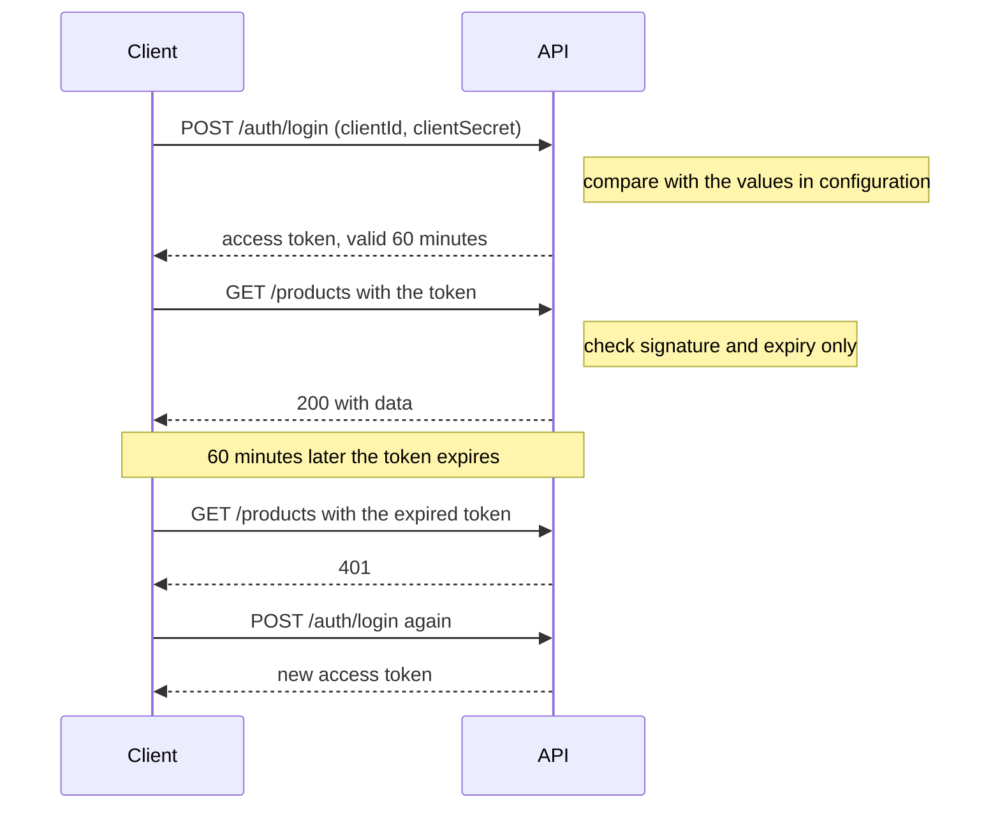
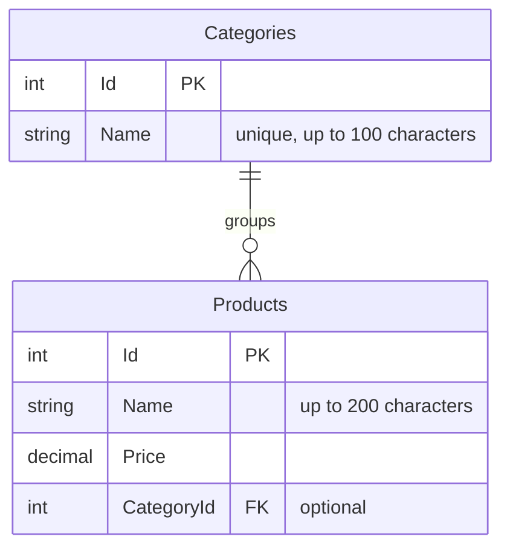

# Standard Minimal Web API

A small, complete reference for building a Web API with:

- **ASP.NET Core Minimal APIs** on .NET 10
- **SQL Server** through **Entity Framework Core** (EF Core)
- **JWT bearer authentication**
- A small **console client** that calls the API, so you can see the workflow end to end

It is meant to be read and learned from. Every pattern here is one you can copy into a real project. This guide assumes
you know some C# but have not built an API like this before.

## Contents

1. [What this project does](#1-what-this-project-does)
2. [Prerequisites](#2-prerequisites)
3. [Run it for the first time](#3-run-it-for-the-first-time)
4. [Try it out](#4-try-it-out)
5. [Key ideas in plain words](#5-key-ideas-in-plain-words)
6. [Tour of the code](#6-tour-of-the-code)
7. [How a request flows through the app](#7-how-a-request-flows-through-the-app)
8. [Authentication in detail](#8-authentication-in-detail)
9. [The database](#9-the-database)
10. [Endpoint reference](#10-endpoint-reference)
11. [Configuration and secrets](#11-configuration-and-secrets)
12. [How to add a new table with endpoints](#12-how-to-add-a-new-table-with-endpoints)
13. [Troubleshooting](#13-troubleshooting)
14. [Practice exercises](#14-practice-exercises)
15. [Deliberately left out](#15-deliberately-left-out)

---

## 1. What this project does

The API manages two kinds of data, **categories** and **products**, with the four standard operations on each: create,
read, update and delete (CRUD).

Every one of those endpoints is protected. A caller must first **log in** with a client id and secret to get a
**token**, then send that token with each request.

The design is deliberately simple:

- **The database holds only business data**: a `Categories` table and a `Products` table.
- **Nothing about login is stored in the database.** There is no users table and no token table. The one allowed
  client id and secret live in configuration, and tokens are checked by their signature alone.

### The big picture

The solution has two programs. The **API** owns the data. The **Client** is a small console app that uses the API the
way any outside program would, so you can watch the whole workflow from the caller's side.

```
  +------------------+     HTTP + JSON      +------------------+       SQL        +--------------+
  |      Client      |  ----------------->  |       API        |  ------------->  |  SQL Server  |
  |  (console app)   |  <-----------------  |  (ASP.NET Core)  |  <-------------  |              |
  |   src/Client     |                      |     src/Api      |                  |  Categories  |
  +------------------+                      +------------------+                  |  Products    |
                                                                                  +--------------+
   knows: client id,                         knows: client id,
          client secret                             client secret,
                                                    signing key
```

The workflow is always the same three moves:

1. The client sends its **id and secret** to `/auth/login`.
2. The API replies with a **token** that is valid for 60 minutes.
3. The client sends that token in the **`Authorization` header** of every later request.

Two things to notice in the picture:

- **The client never talks to the database.** Only the API does.
- **The client never sees the signing key.** It can read a token but cannot make or alter one.

---

## 2. Prerequisites

| Tool | Why | Check it is installed |
|------|-----|-----------------------|
| [.NET 10 SDK](https://dotnet.microsoft.com/download/dotnet/10.0) | Builds and runs the project | `dotnet --list-sdks` shows a `10.0.x` line |
| SQL Server LocalDB | The development database. Installed with Visual Studio, or with SQL Server Express | `sqllocaldb info` lists `MSSQLLocalDB` |
| An HTTP client | To send requests. Visual Studio, Rider and VS Code (REST Client extension) can all run the `Api.http` file | |

`global.json` pins this repo to the .NET 10 SDK, so it builds the same way even if you have newer SDKs installed.

No LocalDB? Any SQL Server works. See [Using a different SQL Server](#using-a-different-sql-server).

---

## 3. Run it for the first time

Run these from the repository root, one at a time.

**Step 1. Restore the EF Core command-line tool.** The repo lists it in `dotnet-tools.json`; this installs that exact
version for this folder only.

```powershell
dotnet tool restore
```

**Step 2. Create the secrets.** There are two: a **signing key**, known only to the API, and a **client secret**, which
the API and the client must both hold. Neither is stored in the repo, so each developer creates their own. This script
generates random values and saves them outside the project folders:

```powershell
function New-RandomSecret {
    $bytes = New-Object byte[] 48
    [Security.Cryptography.RandomNumberGenerator]::Create().GetBytes($bytes)
    [Convert]::ToBase64String($bytes)
}
$clientSecret = New-RandomSecret
dotnet user-secrets set "Jwt:Key" (New-RandomSecret) --project src/Api
dotnet user-secrets set "ApiClient:ClientSecret" $clientSecret --project src/Api
dotnet user-secrets set "Api:ClientSecret" $clientSecret --project src/Client
```

Notice that the same client secret is given to both projects, while the signing key goes to the API only.

You can look at them any time with:

```powershell
dotnet user-secrets list --project src/Api
```

**Step 3. Create the database.** This creates a database named `StandardMinimalWebApi` in LocalDB, builds the two
tables, and inserts a few sample rows.

```powershell
dotnet ef database update --project src/Api
```

**Step 4. Start the API.**

```powershell
dotnet run --project src/Api --launch-profile http
```

The API is now listening on **http://localhost:5106**. Press `Ctrl+C` to stop it.

Opening http://localhost:5106 in a browser should show `{"status":"ok"}`.

---

## 4. Try it out

### Run the client (start here)

Leave the API running, open a **second** terminal in the repository root, and run:

```powershell
dotnet run --project src/Client
```

The client walks through the whole workflow in eight steps and prints every request (`->`) and response (`<-`):

```
--- Step 1: Call a protected endpoint with no token ---
  -> GET /products   (no Authorization header)
  <- 401 Unauthorized   <- the API refuses: we have not proved who we are

--- Step 2: Log in to get a token ---
  -> POST /auth/login   { clientId: "demo-client", clientSecret: "********" }
  <- 200 OK   token of 333 characters, valid until 14:02:06
     The payload is only encoded, not encrypted. Anyone can read it:
       {
         "iss": "standard-minimal-webapi",
         "sub": "demo-client",
         ...
       }

--- Step 3: Call a protected endpoint with the token ---
  -> GET /auth/me   Authorization: Bearer <token>
  <- 200 OK   the API recognises us as "demo-client"
```

| Step | What it shows |
|------|---------------|
| 1 | A protected endpoint refuses a request with no token (401) |
| 2 | Logging in, and what is inside the token |
| 3 | The same kind of request succeeding once the token is attached |
| 4 | Reading: list categories, list products, filter by category |
| 5 | Creating a category and a product in it (201) |
| 6 | Updating the product (200) |
| 7 | What errors look like: validation (400), duplicate (409), not found (404) |
| 8 | Deleting what it created (204), leaving the database as it found it |

Read [src/Client/Program.cs](src/Client/Program.cs) alongside the output: each printed step is a few lines of code.

### Other ways to call the API

**From your editor.** Open [src/Api/Api.http](src/Api/Api.http), paste your client secret into the `@clientSecret`
line at the top (do not commit that change), then click "Send request" above **Login** first and anything else after.
The file remembers the token from the Login response.

**From PowerShell**, while the API is running in another window:

```powershell
$base = "http://localhost:5106"

# 1. Read the client secret you created in step 2
$secret = (dotnet user-secrets list --project src/Api | Select-String '^ApiClient:ClientSecret') -replace '^ApiClient:ClientSecret = ', ''

# 2. Log in and keep the token
$login = @{ clientId = "demo-client"; clientSecret = $secret } | ConvertTo-Json
$token = Invoke-RestMethod -Method Post "$base/auth/login" -Body $login -ContentType "application/json"
$auth = @{ Authorization = "Bearer $($token.accessToken)" }

# 3. Read
Invoke-RestMethod "$base/categories" -Headers $auth
Invoke-RestMethod "$base/products?categoryId=1" -Headers $auth

# 4. Create, update, delete
$new = Invoke-RestMethod -Method Post "$base/products" -Headers $auth -Body '{ "name": "Stapler", "price": 8.5, "categoryId": 1 }' -ContentType "application/json"
Invoke-RestMethod -Method Put "$base/products/$($new.id)" -Headers $auth -Body '{ "name": "Stapler XL", "price": 11 }' -ContentType "application/json"
Invoke-RestMethod -Method Delete "$base/products/$($new.id)" -Headers $auth
```

Try calling `/products` **without** the `-Headers $auth` part. You get `401 Unauthorized`. That is the protection
working.

A machine-readable description of every endpoint (an OpenAPI document) is served at
http://localhost:5106/openapi/v1.json while running in Development.

---

## 5. Key ideas in plain words

**Web API.** A program that answers HTTP requests with data (JSON) instead of web pages. Other programs, such as a web
front end or another system, are its users.

**Endpoint.** One URL plus one HTTP method, such as `GET /products`. Each endpoint runs one C# method, called its
**handler**.

**CRUD and HTTP methods.** The four basic data operations map onto HTTP methods:

| Operation | HTTP method | Example |
|-----------|-------------|---------|
| Create    | `POST`      | `POST /products` |
| Read      | `GET`       | `GET /products` or `GET /products/1` |
| Update    | `PUT`       | `PUT /products/1` |
| Delete    | `DELETE`    | `DELETE /products/1` |

**Minimal API.** The ASP.NET Core style used here, where you map a URL straight to a handler method:
`group.MapGet("/", GetAll)`. The older alternative is controller classes. Both do the same job; Minimal APIs need less
code.

**EF Core.** A library that lets you work with database rows as C# objects. You write `db.Products.Add(product)` and
EF Core writes the SQL `INSERT` for you.

**Migration.** A generated C# file that describes one change to the database structure, such as "create the Products
table". Migrations are stored in the repo, so every developer and every server ends up with the same tables.

**Dependency injection (DI).** You register services once in `Program.cs`. After that, any handler can ask for one just
by listing it as a parameter. When a handler has an `AppDbContext db` parameter, ASP.NET Core creates the `AppDbContext`
and passes it in. You never write `new AppDbContext(...)` yourself.

**JWT (JSON Web Token).** A signed piece of text that says who the caller is and when the token expires. The API
creates it at login and signs it with a secret key. On later requests the API checks the signature; if it is valid, the
API trusts the contents **without looking anything up**. That is why this project needs no token table. You can paste
a token into https://jwt.io to see inside. The contents are readable by anyone, so never put secrets in a token.

**Client id and client secret.** A username and password for a program rather than a person. This API has exactly one,
kept in configuration.

---

## 6. Tour of the code

```
standard-minimal-webapi/
├── StandardMinimalWebApi.slnx   the solution file; open this in Visual Studio or Rider
├── global.json                  pins the .NET SDK version
├── dotnet-tools.json            pins the EF Core command-line tool version
├── AGENTS.md, docs/agents/      settings for AI coding assistants; not part of the API
├── src/Client/                  the console app that calls the API
│   ├── Program.cs               the eight-step walkthrough
│   ├── ApiClient.cs             one method per endpoint; handles login and the token
│   ├── Models.cs                the JSON shapes, as C# records
│   └── appsettings.json         the API's address and the client id
└── src/Api/                     the API itself
    ├── Program.cs               START HERE: registers services and wires everything up
    ├── appsettings.json         non-secret settings (connection string, token lifetime)
    ├── Api.http                 sample requests you can run from your editor
    ├── Auth/
    │   ├── ApiClientOptions.cs  the allowed client id and secret, as a C# class
    │   ├── JwtOptions.cs        the token settings, as a C# class
    │   ├── TokenService.cs      creates a token
    │   └── AuthEndpoints.cs     /auth/login and /auth/me
    ├── Categories/
    │   └── CategoryEndpoints.cs /categories endpoints
    ├── Products/
    │   └── ProductEndpoints.cs  /products endpoints
    ├── Entities/                one class per database table
    │   ├── Category.cs
    │   └── Product.cs
    └── Data/
        ├── AppDbContext.cs      the gateway to the database; table rules and sample rows
        └── Migrations/          generated files; do not edit by hand
```

**Suggested reading order:**

1. [Program.cs](src/Api/Program.cs) — short, and shows how the pieces connect.
2. [Entities/Category.cs](src/Api/Entities/Category.cs) and
   [Categories/CategoryEndpoints.cs](src/Api/Categories/CategoryEndpoints.cs) — the simplest complete feature.
3. [Products/ProductEndpoints.cs](src/Api/Products/ProductEndpoints.cs) — the same pattern plus a link to another table.
4. [Data/AppDbContext.cs](src/Api/Data/AppDbContext.cs) — how the tables are configured.
5. [Auth/AuthEndpoints.cs](src/Api/Auth/AuthEndpoints.cs) and [Auth/TokenService.cs](src/Api/Auth/TokenService.cs) —
   the login logic.
6. [Client/ApiClient.cs](src/Client/ApiClient.cs) — the same conversation from the caller's side.

### How the client is built

The client has three small files:

- **[Models.cs](src/Client/Models.cs)** holds records matching the API's JSON. They are written again here instead of
  being shared with the API project, because a real client is a separate program that knows the API only through its
  JSON.
- **[ApiClient.cs](src/Client/ApiClient.cs)** has one method per endpoint, such as `GetProductsAsync()` and
  `CreateCategoryAsync(name)`. Every protected call goes through one private `SendAsync` method, which does three
  things: logs in if there is no token or it is about to expire, adds the `Authorization: Bearer <token>` header, and
  turns any error response into an `ApiException`.
- **[Program.cs](src/Client/Program.cs)** is the walkthrough. It only calls `ApiClient` methods and prints.

The idea worth copying is that **token handling lives in one place**. The rest of the program just calls
`api.GetProductsAsync()` and never thinks about logging in.

### The pattern every feature follows

Each feature folder (`Products`, `Categories`) has one file with three parts:

**1. Request and response records.** These define the JSON going in and out. They are separate from the entity class on
purpose, so the JSON shape can differ from the table shape.

```csharp
public record CategoryRequest([property: Required, MaxLength(100)] string Name);
public record CategoryResponse(int Id, string Name);
```

The attributes (`Required`, `MaxLength`) are validation rules. If a request breaks one, the API replies `400` with the
reason before your handler even runs. This is switched on by `builder.Services.AddValidation()` in `Program.cs`.

**2. A `Map...Endpoints` method.** This lists the URLs and connects each to its handler.

```csharp
var group = app.MapGroup("/categories").WithTags("Categories").RequireAuthorization();
group.MapGet("/", GetAll);
group.MapPost("/", Create);
```

`RequireAuthorization()` on the group is what makes every endpoint in it demand a valid token.

**3. The handlers.** One method per endpoint.

```csharp
private static async Task<Results<NoContent, NotFound>> Delete(int id, AppDbContext db, CancellationToken ct)
{
    var deleted = await db.Categories.Where(c => c.Id == id).ExecuteDeleteAsync(ct);
    return deleted == 0 ? TypedResults.NotFound() : TypedResults.NoContent();
}
```

Things to notice:

- **Parameters are filled in automatically.** `id` comes from the URL, `db` from dependency injection, and a request
  record (when present) from the JSON body.
- **The return type lists every possible outcome.** `Results<NoContent, NotFound>` means "either 204 or 404". The
  compiler stops you returning anything else, and the OpenAPI document is generated from it. This is why the code uses
  `TypedResults` rather than `Results`.
- **`CancellationToken ct`** lets the database call stop early if the caller disconnects.

---

## 7. How a request flows through the app

Take `GET /products` with a token. The request passes through the steps set up at the bottom of
[Program.cs](src/Api/Program.cs), in order:

1. **Exception handler.** Wraps everything that follows. If any later step crashes, the caller gets a clean `500`
   response instead of a stack trace.
2. **Authentication.** Reads the `Authorization` header. If it holds a valid token, the request now has a known caller.
   A missing or bad token is not an error yet; the request simply has no caller.
3. **Authorization.** Checks whether this endpoint requires a caller. `/products` does, so a request without one stops
   here with **401 Unauthorized**.
4. **Validation.** Checks the request body against the rules on the request record. A broken rule stops the request
   here with **400** and the reasons.
5. **Handler.** Your method runs, talks to the database, and returns a result.
6. **Response.** The result is written out as JSON with its status code.

Steps 1 to 3 are **middleware**: code that every request passes through. Their order in `Program.cs` matters;
authentication must come before authorization.

**Error responses always have the same shape**, called Problem Details:

```json
{
  "title": "One or more validation errors occurred.",
  "status": 400,
  "errors": { "Name": ["The Name field is required."] }
}
```

---

## 8. Authentication in detail

### The whole flow



The database is not involved in any of this.

### What is inside a token

Created in [TokenService.cs](src/Api/Auth/TokenService.cs). Each piece of information is called a **claim**:

| Claim | Meaning                                  |
|-------|------------------------------------------|
| `sub` | Subject: the client id that logged in    |
| `jti` | A unique id for this token               |
| `iss` | Issuer: who created the token (this API) |
| `aud` | Audience: who the token is meant for     |
| `exp` | When it expires                          |

A handler can read the caller from these claims. See `Me` in [AuthEndpoints.cs](src/Api/Auth/AuthEndpoints.cs).

### How a token is checked

Set up in [Program.cs](src/Api/Program.cs) under `TokenValidationParameters`. A token is accepted only if **all** of
these hold: the signature matches our key, the issuer matches, the audience matches, and it has not expired.

### Security rules this project follows

- **The signing key and the client secret are never in source control.**
- **Login gives the same error whether the id or the secret was wrong**, and compares them in constant time, so the
  response reveals nothing about which part was incorrect.
- **The app refuses to start** if either secret is missing or too short.

### What this simple design cannot do

Because nothing is stored, **a token cannot be cancelled**. Once issued, it works until it expires, 60 minutes later.
There is also no logout and no way to stay logged in without calling `/auth/login` again.

If you need those, the usual answer is **refresh tokens** stored in a database table. That is a good thing to learn
next, but it is deliberately not part of this project.

---

## 9. The database

### The two tables



- A product belongs to **one category or none**.
- Deleting a **category** keeps its products and sets their `CategoryId` to empty.

Column sizes, the unique rule, this delete behaviour and the sample rows are all defined in
[AppDbContext.cs](src/Api/Data/AppDbContext.cs).

### Sample data

Creating the database inserts three categories (Tools, Garden, Kitchen) and six products, so there is something to
query straight away. To get back to exactly this starting data at any time, delete and recreate the database:

```powershell
dotnet ef database drop --force --project src/Api
```

```powershell
dotnet ef database update --project src/Api
```

### Looking at the data

Connect any SQL tool (SQL Server Management Studio, Azure Data Studio, or the SQL Server Object Explorer in Visual
Studio) to server `(localdb)\MSSQLLocalDB` using Windows authentication, and open the `StandardMinimalWebApi` database.

### Changing the database structure

Never edit tables by hand. Change the C# and let EF Core generate the migration:

1. Edit a class in `Entities/`, or the rules in `AppDbContext.cs`.
2. Generate a migration. Give it a name that describes the change:

   ```powershell
   dotnet ef migrations add AddProductDescription --project src/Api -o Data/Migrations
   ```

3. Read the new file in `Data/Migrations/` to confirm it does what you expect.
4. Apply it to your database:

   ```powershell
   dotnet ef database update --project src/Api
   ```

5. Commit the migration files along with your code change.

To undo the last migration before it has been applied or shared:

```powershell
dotnet ef migrations remove --project src/Api
```

### Using a different SQL Server

Change `ConnectionStrings:Default`. Do not put a password in `appsettings.json`; store the whole connection string as a
user secret instead, which overrides the file:

```powershell
dotnet user-secrets set "ConnectionStrings:Default" "Server=localhost;Database=StandardMinimalWebApi;Trusted_Connection=True;TrustServerCertificate=True" --project src/Api
```

---

## 10. Endpoint reference

"Bearer" means the request must include the header `Authorization: Bearer <access token>`.

### Auth

| Method | Path          | Auth   | Body                       | Success | Failures |
|--------|---------------|--------|----------------------------|---------|----------|
| POST   | `/auth/login` | none   | `clientId`, `clientSecret` | 200 with a token | 400 a field is empty, 401 wrong id or secret |
| GET    | `/auth/me`    | bearer |                            | 200 with the client id | 401 |

A successful login returns:

```json
{
  "accessToken": "eyJhbGciOi...",
  "tokenType": "Bearer",
  "expiresAt": "2026-11-20T21:52:39+00:00"
}
```

### Categories (all require bearer)

| Method | Path               | Body   | Success | Failures |
|--------|--------------------|--------|---------|----------|
| GET    | `/categories`      |        | 200 with a list, sorted by name | |
| GET    | `/categories/{id}` |        | 200     | 404 |
| POST   | `/categories`      | `name` | 201     | 400 invalid input, 409 name already used |
| PUT    | `/categories/{id}` | `name` | 200     | 400, 404, 409 name already used |
| DELETE | `/categories/{id}` |        | 204     | 404 |

### Products (all require bearer)

| Method | Path             | Body | Success | Failures |
|--------|------------------|------|---------|----------|
| GET    | `/products`      |      | 200 with a list. Add `?categoryId=1` to show one category only | |
| GET    | `/products/{id}` |      | 200     | 404 |
| POST   | `/products`      | `name`, `price`, optional `categoryId` | 201 | 400 invalid input or unknown category |
| PUT    | `/products/{id}` | `name`, `price`, optional `categoryId` | 200 | 400, 404 |
| DELETE | `/products/{id}` |      | 204     | 404 |

A product looks like this. `categoryId` and `categoryName` are `null` when the product has no category.

```json
{
  "id": 1,
  "name": "Hammer",
  "price": 15.00,
  "categoryId": 1,
  "categoryName": "Tools"
}
```

Every protected endpoint also returns **401** when the token is missing, invalid or expired.

### Status codes used

| Code | Meaning in this API |
|------|---------------------|
| 200  | Success, with data |
| 201  | Created; the `Location` header holds the new item's URL |
| 204  | Success, nothing to return |
| 400  | The request body broke a validation rule |
| 401  | No valid token, or wrong client id or secret |
| 404  | No item with that id |
| 409  | Conflicts with existing data, such as a duplicate name |

---

## 11. Configuration and secrets

Settings are read from several places. Later ones override earlier ones:

1. `appsettings.json` — committed to the repo; safe, non-secret defaults.
2. `appsettings.Development.json` — applies only when running locally.
3. **User secrets** — stored in your user profile, outside the repo; local development only.
4. **Environment variables** — how a real server supplies settings.

| Setting                     | Default | Purpose |
|-----------------------------|---------|---------|
| `ConnectionStrings:Default` | LocalDB | Which database to use |
| `Jwt:Issuer`                | `standard-minimal-webapi` | Written into each token and checked on the way back |
| `Jwt:Audience`              | `standard-minimal-webapi-clients` | Same |
| `Jwt:ExpiryMinutes`         | `60`    | How long a token lasts |
| `Jwt:Key`                   | none    | **Secret.** Signs tokens; at least 32 characters |
| `ApiClient:ClientId`        | `demo-client` | The id the caller logs in with |
| `ApiClient:ClientSecret`    | none    | **Secret.** The caller's password; at least 16 characters |

Those are the API's settings. The client has three of its own, in `src/Client`:

| Setting            | Default | Purpose |
|--------------------|---------|---------|
| `Api:BaseUrl`      | `http://localhost:5106` | Where the API is |
| `Api:ClientId`     | `demo-client` | Must match the API's `ApiClient:ClientId` |
| `Api:ClientSecret` | none    | **Secret.** Must match the API's `ApiClient:ClientSecret` |

**Rule: secrets never go in `appsettings.json`.** That file is in source control and visible to everyone with access to
the repo.

On a server, set environment variables instead. Replace each `:` with two underscores:

```powershell
$env:Jwt__Key = "<a long random value>"
$env:ApiClient__ClientSecret = "<another long random value>"
$env:ConnectionStrings__Default = "<production connection string>"
```

The app checks these settings at startup and refuses to start if any are missing or too short. The rules are in
[JwtOptions.cs](src/Api/Auth/JwtOptions.cs) and [ApiClientOptions.cs](src/Api/Auth/ApiClientOptions.cs).

Changing `Jwt:Key` makes every token issued so far invalid.

---

## 12. How to add a new table with endpoints

Say you want to add **Suppliers**. Copy what `Categories` does:

1. **Create the entity.** Add `Entities/Supplier.cs` with an `Id` and your columns. Use
   [Category.cs](src/Api/Entities/Category.cs) as the template.
2. **Register the table.** In [AppDbContext.cs](src/Api/Data/AppDbContext.cs), add
   `public DbSet<Supplier> Suppliers => Set<Supplier>();` and, inside `OnModelCreating`, any length limits or unique
   rules.
3. **Create the migration and apply it.**

   ```powershell
   dotnet ef migrations add AddSuppliers --project src/Api -o Data/Migrations
   ```

   ```powershell
   dotnet ef database update --project src/Api
   ```

4. **Create the endpoints.** Copy [CategoryEndpoints.cs](src/Api/Categories/CategoryEndpoints.cs) to
   `Suppliers/SupplierEndpoints.cs` and rename as you go: the namespace, the records, the route (`/suppliers`), the tag,
   and the route name (`GetSupplierById`).
5. **Switch the endpoints on.** In [Program.cs](src/Api/Program.cs), add `app.MapSupplierEndpoints();` beside the other
   `Map...` calls, and the matching `using Api.Suppliers;` at the top.
6. **Add sample requests** to [Api.http](src/Api/Api.http) and run them.

To link the new table to another one, see how `Product.CategoryId` is done in
[Product.cs](src/Api/Entities/Product.cs), [AppDbContext.cs](src/Api/Data/AppDbContext.cs) and the
`ResolveCategoryAsync` method in [ProductEndpoints.cs](src/Api/Products/ProductEndpoints.cs).

---

## 13. Troubleshooting

| Symptom | Likely cause and fix |
|---------|----------------------|
| App stops at startup with `DataAnnotation validation failed for 'JwtOptions'` or `'ApiClientOptions'` | A secret is not set on this machine. Run step 2 of [Run it for the first time](#3-run-it-for-the-first-time). |
| `Cannot open database "StandardMinimalWebApi"` or `Invalid object name 'Products'` | The database is missing or behind. Run `dotnet ef database update --project src/Api`. |
| `A network-related or instance-specific error` when connecting | LocalDB is not installed or not started. Run `sqllocaldb start MSSQLLocalDB`, or point the connection string at another SQL Server. |
| `dotnet ef` is not recognised | Run `dotnet tool restore` from the repository root. |
| Client prints `Could not reach the API` | The API is not running. Start it in another terminal with `dotnet run --project src/Api --launch-profile http`. |
| Client prints `The client secret is not set` | Run step 2 of [Run it for the first time](#3-run-it-for-the-first-time). |
| Client prints `401 Invalid client id or secret` | The client's `Api:ClientSecret` differs from the API's `ApiClient:ClientSecret`. Run step 2 again to set both to the same value, then restart the API. |
| `/auth/login` returns 401 | The client id or secret does not match configuration. Check them with `dotnet user-secrets list --project src/Api`. |
| Every protected call returns 401 | The header must be exactly `Authorization: Bearer <access token>`. The token may also be over 60 minutes old; log in again. |
| All tokens stopped working after a config change | `Jwt:Key`, `Jwt:Issuer` or `Jwt:Audience` changed. Old tokens no longer match. Log in again. |
| Warning `Failed to determine the https port for redirect` | Harmless when using the `http` launch profile. Use `--launch-profile https` to run with HTTPS on port 7229. |
| `address already in use` on start | Another copy of the API is still running. Stop it, or change the port in `src/Api/Properties/launchSettings.json`. |
| Build error mentioning a package that needs `net11.0` | A package was upgraded past version 10. This project targets .NET 10, so keep `Microsoft.*` packages on `10.0.x`. |

---

## 14. Practice exercises

The best way to learn this code is to change it. These go from easy to hard.

**Explore**

1. Log in, copy the `accessToken`, and paste it into https://jwt.io. Find the client id and the expiry time.
2. Set `Jwt:ExpiryMinutes` to `1` in `appsettings.json`, restart, log in, and wait two minutes. Watch a protected call
   start returning 401.
3. Change one character in the middle of a token and send it. Explain the result using the checks listed in
   [section 8](#how-a-token-is-checked).
4. Create, rename and delete a category through the API while watching the `Categories` table in a SQL tool.
5. Run the client with the API's log level turned up (set `Microsoft.AspNetCore` to `Information` in
   `src/Api/appsettings.Development.json`) and match each client step to the lines the API prints.

**Small changes**

6. Add a `Description` column to `Product` (optional, up to 1000 characters). You will touch the entity, the request
   and response records, the handlers, and add a migration.
7. Add a rule that a product's price must be greater than zero, and check that the API returns 400 for `0`.
8. Make `GET /categories` also return how many products each category has.

**New features**

9. Add a `Suppliers` table with full CRUD by following
   [section 12](#12-how-to-add-a-new-table-with-endpoints).
10. Add paging to `GET /products` with `?page=1&pageSize=20`.
11. Add a `GET /products/search?name=ham` endpoint that finds products whose name contains the text.

**Harder**

12. Allow more than one client: change `ApiClient` in configuration to a list, and accept any of them at login.
13. Add a `scope` claim to the token (for example `read` or `read write`) and allow only `write` tokens to call the
    POST, PUT and DELETE endpoints.
14. Add a test project and write a test that logs in and creates a product.
15. Add a `Suppliers` section to the client once exercise 9 is done: models, `ApiClient` methods and a walkthrough
    step.

---

## 15. Deliberately left out

To stay small, this reference does not include the following. A real project may need them:

- **Automated tests.**
- **User accounts.** There is one client id and secret in configuration, not a table of users with passwords.
- **Refresh tokens and logout.** A token cannot be cancelled before it expires.
- **Permissions.** Any valid token can do everything.
- **Rate limiting** on `/auth/login`, to slow down secret guessing.
- **Paging** on the list endpoints. They return every row.
- **CORS settings**, needed if a browser app on another address calls this API.
- **Structured logging, health checks and deployment setup.**
